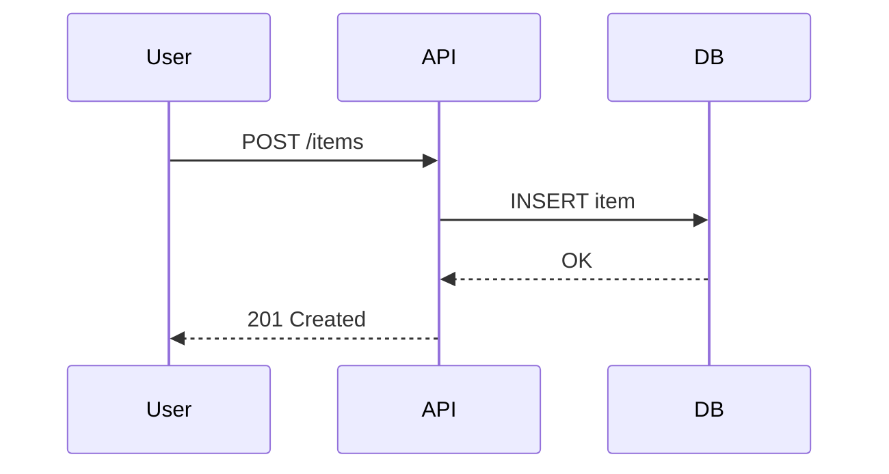
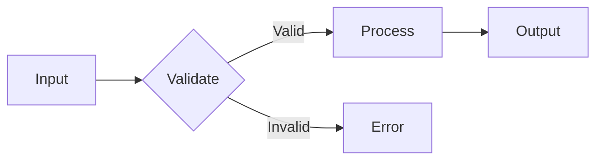

# Phase 14: Foundations - Research

**Researched:** 2026-03-21
**Domain:** Agent prompt engineering, shell scripting, documentation framework configuration
**Confidence:** HIGH

## Summary

Phase 14 delivers three independent feature clusters to the doc-writer plugin: (1) Concepts page awareness in the doc-author agent, (2) mermaid diagram support across all four documentation frameworks, and (3) an OCaml language case for the scan-exports.sh script. All three clusters modify different files with zero overlap, making them safe to implement in parallel or any order.

The research confirms this is a low-risk phase. The doc-author.md agent prompt needs two new behavioral sections (Concepts page proposal in Phase 1 inventory, and mermaid diagram type recommendation in Phase 2 writing). Each of the four framework guidance files (mkdocs-material.md, sphinx-shibuya.md, odoc.md, plain-markdown.md) needs a new "Mermaid Diagrams" section documenting the correct wrapper syntax for that framework. The sphinx-shibuya scaffold (conf.py template) needs `sphinxcontrib.mermaid` added to its extensions list. The scan-exports.sh script needs an `ocaml` case scanning `.mli` files. The mkdocs-material scaffold already has mermaid support via pymdownx.superfences -- no changes needed there.

**Primary recommendation:** Implement as two plans: Plan 14-01 covers Concepts page awareness + mermaid diagram support (doc-author.md changes + all four guidance files + sphinx-shibuya scaffold), Plan 14-02 covers the OCaml scan-exports case (standalone shell script change).

<phase_requirements>
## Phase Requirements

| ID | Description | Research Support |
|----|-------------|-----------------|
| CONT-04 | Author proposes optional Concepts page(s) under Explanation by default, refined in page inventory Q&A | New section in doc-author.md Phase 1 inventory rules; Concepts pages classified as `explanation` type with "(concepts)" sub-type marker |
| CONT-05 | Author recommends appropriate mermaid diagram types (flowchart, sequence, state, class) based on content area | New section in doc-author.md Phase 2 writing workflow; diagram type selection heuristic based on content domain |
| MERM-01 | Doc-author aware of mermaid diagrams and uses them when appropriate across all four doc systems | CONT-05 section in doc-author.md covers awareness; framework guidance files provide syntax per system |
| MERM-02 | Each framework guidance file includes mermaid syntax section with correct wrapper format | New "Mermaid Diagrams" section in each of: mkdocs-material.md, sphinx-shibuya.md, odoc.md, plain-markdown.md |
| MERM-03 | sphinxcontrib-mermaid added to sphinx-shibuya scaffold and guidance | Add `sphinxcontrib.mermaid` to extensions in scaffold conf.py; add mermaid config options to guidance |
| MERM-04 | Odoc mermaid handled as guidance-only workaround (no native support) | Confirmed: odoc has no native mermaid. Guidance documents `{v ... v}` verbatim block + external SVG workaround |
| OCML-01 | scan-exports.sh has OCaml language case scanning .mli files for public symbols (val, type, module) | New `ocaml` case in scan-exports.sh using grep on .mli files for `^val `, `^type `, `^module ` patterns |
</phase_requirements>

## Standard Stack

### Core

No new runtime dependencies are introduced by Phase 14. The doc-writer plugin is a Claude Code plugin consisting of markdown agent prompts, shell scripts, and YAML configuration -- there are no npm/pip packages to install for the plugin itself.

### Supporting

| Library | Version | Purpose | When to Use |
|---------|---------|---------|-------------|
| sphinxcontrib-mermaid | >= 2.0.1 | Mermaid diagram rendering in Sphinx | Added to sphinx-shibuya scaffold conf.py; installed by end users when they scaffold a sphinx-shibuya project |

**Version verification:** sphinxcontrib-mermaid 2.0.1 confirmed on PyPI, released 2026-03-05. Requires Python >= 3.10.

### What NOT to Add (Out of Scope per REQUIREMENTS.md)

| Do Not Add | Why |
|------------|-----|
| mkdocs-mermaid2-plugin | Redundant; pymdownx.superfences already handles mermaid in mkdocs-material (scaffold already configured) |
| odoc-mermaid-extension | Experimental, not on opam stable, not production-ready |
| myst-parser | Locked decision: RST-native only, no Markdown in Sphinx |

## Architecture Patterns

### Files Modified by This Phase

```
doc-writer/
  agents/
    doc-author.md              # Add Concepts page proposal + mermaid diagram sections
  skills/
    setup/
      defaults/
        mkdocs-material.md     # Add Mermaid Diagrams section
        sphinx-shibuya.md      # Add Mermaid Diagrams section
        odoc.md                # Add Mermaid Diagrams section (workaround guidance)
        plain-markdown.md      # Add Mermaid Diagrams section
        scaffolds/
          sphinx-shibuya.py    # Add sphinxcontrib.mermaid to extensions
    write/
      scripts/
        scan-exports.sh        # Add ocaml) case
```

### Pattern 1: Concepts Page Proposal in Doc-Author Phase 1

**What:** The doc-author agent, during Phase 1 (Scan and Plan), should propose one or more Concepts pages under the Explanation quadrant as part of the page inventory. These pages are classified as type `explanation` in the inventory table.

**When to use:** Every project inventory. The author scans for core abstractions, domain-specific terminology, and architectural patterns that warrant conceptual explanation. If the project has non-trivial domain concepts, at least one Concepts page should be proposed.

**How it works in the existing architecture:**
- The doc-author already proposes `explanation` pages (see Phase 1 Step 3 in doc-author.md)
- Concepts pages are a sub-category of explanation -- they use the same diataxis reference file (`skills/diataxis/references/explanation.md`)
- The inventory table already supports the `explanation` type
- The change is behavioral: add guidance text that instructs the author to specifically consider "What is X?" conceptual pages during inventory, using the Concept Explanation pattern from the explanation reference

**Example inventory entry:**
```
| 5 | explanation | Understanding {Core Concept} | What it is, why it exists, how it works, trade-offs | docs/explanation/understanding-{concept}.md |
```

**Where to add in doc-author.md:** After the existing Step 3 "Inventory rules" bullet list, add a new sub-section on Concepts page awareness.

### Pattern 2: Mermaid Diagram Type Recommendation

**What:** The doc-author agent, during Phase 2 (Write), recommends appropriate mermaid diagram types based on what content area is being documented. This is guidance embedded in the agent prompt, not a separate tool or configuration.

**Diagram type selection heuristic:**

| Content Area | Recommended Diagram Type | Why |
|-------------|-------------------------|-----|
| API request/response flows, multi-step interactions | `sequenceDiagram` | Shows temporal ordering of messages between participants |
| Decision trees, process flows, pipelines | `flowchart` (or `graph TD`/`graph LR`) | Shows branching logic and directional flow |
| Lifecycle states, state machines, status transitions | `stateDiagram-v2` | Shows states and transitions between them |
| Type hierarchies, module relationships, data models | `classDiagram` | Shows structural relationships and inheritance |

**Where to add in doc-author.md:** In the Phase 2 writing workflow, after the general writing workflow steps, add a section on mermaid diagram awareness. The author should consider diagrams when writing explanation pages (architectural concepts benefit from flowcharts and sequence diagrams) and how-to pages with multi-step processes (flowcharts).

**Key constraint:** The doc-author reads the framework guidance file at runtime to determine the correct mermaid wrapper syntax. The agent prompt should NOT hardcode syntax -- it should say "use the mermaid syntax from the guidance file."

### Pattern 3: Framework Guidance Mermaid Sections

**What:** Each framework guidance file gets a new "Mermaid Diagrams" section documenting the correct syntax for embedding mermaid diagrams in that framework.

**Mermaid wrapper syntax per framework:**

| Framework | Wrapper Syntax | Notes |
|-----------|---------------|-------|
| mkdocs-material | ` ```mermaid ` fenced code block | Already supported via pymdownx.superfences custom fence in scaffold |
| sphinx-shibuya | `.. mermaid::` RST directive | Requires sphinxcontrib.mermaid extension in conf.py |
| plain-markdown | ` ```mermaid ` fenced code block | GitHub renders natively; other renderers may not |
| odoc | `{v ... v}` verbatim block + external SVG | No native mermaid; guidance-only workaround |

**Section placement:** Add as a new top-level `## Mermaid Diagrams` section in each guidance file, after the existing code-related sections.

### Pattern 4: Sphinx-Shibuya Scaffold Extension

**What:** The scaffold template `scaffolds/sphinx-shibuya.py` adds `sphinxcontrib.mermaid` to the extensions list and optionally adds mermaid configuration.

**Current extensions list:**
```python
extensions = [
    "sphinx.ext.intersphinx",
    "sphinx.ext.napoleon",
    "sphinx_design",
    "autoapi.extension",
]
```

**Updated extensions list:**
```python
extensions = [
    "sphinx.ext.intersphinx",
    "sphinx.ext.napoleon",
    "sphinx_design",
    "autoapi.extension",
    "sphinxcontrib.mermaid",
]
```

**Optional mermaid config to add below extensions:**
```python
# -- Mermaid diagrams ----------------------------------------------------------

mermaid_version = ""  # empty string = use bundled version from sphinxcontrib-mermaid
```

The empty string for `mermaid_version` lets sphinxcontrib-mermaid use its bundled default (currently 11.12.1). Shibuya theme handles dark/light mode automatically.

### Pattern 5: OCaml scan-exports Case

**What:** A new `ocaml` case in scan-exports.sh that scans `.mli` files for public symbol declarations.

**OCaml .mli public symbol patterns:**

| Symbol Type | Grep Pattern | Example Match |
|------------|-------------|---------------|
| Values/functions | `^val ` | `val hello : unit -> unit` |
| Type declarations | `^type ` | `type t = { name : string; age : int }` |
| Module declarations | `^module ` | `module Sub : sig ... end` |
| Module type declarations | `^module type ` | `module type S = sig ... end` |
| Exception declarations | `^exception ` | `exception Not_found` |

**Implementation approach:** Follow the exact same pattern as the existing `python`, `go`, and `rust` cases -- grouped grep commands with section headers. Scan `.mli` files only (not `.ml` files, which contain implementation details). The EXCLUDE variable already handles common non-source directories.

### Anti-Patterns to Avoid

- **Do not add mermaid syntax inline in doc-author.md:** The author prompt should reference the guidance file for syntax, not hardcode it. This keeps the prompt framework-agnostic.
- **Do not create a separate "concepts" page type:** Concepts pages ARE explanation pages. They use the `explanation` type in the inventory. Do not create a new diataxis type.
- **Do not scan `.ml` files in the OCaml export scanner:** Only `.mli` files define the public interface. Scanning `.ml` files would pick up internal implementation details.
- **Do not add mermaid to the mkdocs-material scaffold:** It is already there via the pymdownx.superfences custom fence configuration.

## Don't Hand-Roll

| Problem | Don't Build | Use Instead | Why |
|---------|-------------|-------------|-----|
| Mermaid rendering in Sphinx | Custom JS injection | sphinxcontrib-mermaid extension | Handles output formats, theme integration, version management |
| Mermaid rendering in MkDocs | Custom plugin | pymdownx.superfences custom fence (already in scaffold) | Built-in support, zero config needed |
| OCaml symbol parsing | Custom parser | grep patterns on .mli files | .mli syntax is regular enough for line-oriented grep; a parser is overkill for export scanning |
| Diagram type selection | ML classifier | Simple heuristic table in agent prompt | Content-area-to-diagram-type mapping is small and stable; an algorithm adds complexity for no value |

## Common Pitfalls

### Pitfall 1: Mermaid Syntax Portability
**What goes wrong:** Writing mermaid code in the wrong wrapper format for the framework silently produces raw text or a code block instead of a rendered diagram.
**Why it happens:** Three different wrappers exist across four frameworks. The doc-author could default to markdown fenced blocks for all frameworks.
**How to avoid:** Each framework guidance file documents the correct wrapper. The doc-author prompt explicitly instructs reading the guidance file before writing diagrams. Do not hardcode any wrapper syntax in the agent prompt.
**Warning signs:** Mermaid code appearing as text in rendered docs; `.. mermaid::` directive showing as literal text in MkDocs output.

### Pitfall 2: sphinxcontrib-mermaid Not in Install Instructions
**What goes wrong:** User scaffolds a sphinx-shibuya project, conf.py references sphinxcontrib.mermaid, but `pip install` instructions in setup flow do not mention it. Sphinx build fails with `Extension error: Could not import extension sphinxcontrib.mermaid`.
**Why it happens:** The scaffold adds the extension but the install command in the setup SKILL.md only mentions the base sphinx packages.
**How to avoid:** The sphinx-shibuya guidance file's mermaid section should note that `pip install sphinxcontrib-mermaid` is needed. The setup SKILL.md's install command surface step (Step 2b.3.f) should include it.
**Warning signs:** Sphinx build errors referencing missing sphinxcontrib.mermaid module.

### Pitfall 3: Concepts Pages Duplicating Explanation Pattern
**What goes wrong:** The Concepts page proposal creates confusion about whether "Concepts" is a new documentation type or a sub-pattern of Explanation.
**Why it happens:** The diataxis framework explicitly rejects a 5th documentation type. "Concepts" could be misinterpreted as a new quadrant.
**How to avoid:** The doc-author prompt must frame Concepts as a specific pattern WITHIN the Explanation quadrant, not alongside it. Use the type `explanation` in the inventory. Reference the "Pattern 1: Concept Explanation" template from the existing explanation reference file.
**Warning signs:** Inventory showing a `concepts` type instead of `explanation`; doc-editor type integrity pass failing on Concepts pages.

### Pitfall 4: OCaml scan-exports Missing Multi-line Declarations
**What goes wrong:** `grep '^val '` misses val declarations that are indented inside `sig ... end` blocks in .mli files.
**Why it happens:** OCaml modules can have nested signature blocks where val declarations are indented.
**How to avoid:** This is acceptable. The scan-exports.sh script is a lightweight gap detector, not a full parser. The doc-author agent does its own deep scan in Phase 1 (Step 2). Missing some nested vals in the grep output is a minor gap -- the agent will find them during codebase scan. All other language cases (python, go, rust) also use simple line-oriented grep.
**Warning signs:** Low symbol count from scan-exports for projects with many nested modules. This is a known limitation, not a bug.

### Pitfall 5: odoc Mermaid Workaround Suggesting Unsupported Extensions
**What goes wrong:** Guidance suggests using an odoc mermaid extension that is experimental and not on opam stable.
**Why it happens:** Natural impulse to find a "real" solution instead of a workaround.
**How to avoid:** REQUIREMENTS.md explicitly excludes odoc-mermaid-extension. The guidance should document the verbatim block + external SVG approach as a workaround and note that native mermaid is not supported in odoc.
**Warning signs:** Guidance mentioning `odoc-mermaid` package or any non-standard extension.

## Code Examples

### OCaml scan-exports.sh Case

```bash
# Source: follows existing pattern in scan-exports.sh for python/go/rust
ocaml)
  echo "## OCaml Public Values"
  grep -rn '^val ' "$SOURCE_ROOT" --include="*.mli" $EXCLUDE 2>/dev/null || true
  echo ""
  echo "## OCaml Type Declarations"
  grep -rn '^type ' "$SOURCE_ROOT" --include="*.mli" $EXCLUDE 2>/dev/null || true
  echo ""
  echo "## OCaml Module Declarations"
  grep -rn '^module ' "$SOURCE_ROOT" --include="*.mli" $EXCLUDE 2>/dev/null || true
  echo ""
  echo "## OCaml Exception Declarations"
  grep -rn '^exception ' "$SOURCE_ROOT" --include="*.mli" $EXCLUDE 2>/dev/null || true
  ;;
```

### Mermaid Syntax: MkDocs-Material

```markdown
<!-- Source: pymdownx.superfences custom fence, already in mkdocs-material scaffold -->

```

### Mermaid Syntax: Sphinx-Shibuya (RST)

```rst
.. Source: sphinxcontrib-mermaid 2.0 directive syntax
.. mermaid::

   sequenceDiagram
      participant User
      participant API
      participant DB
      User->>API: POST /items
      API->>DB: INSERT item
      DB-->>API: OK
      API-->>User: 201 Created
```

### Mermaid Syntax: Plain Markdown (GitHub-compatible)

````markdown
<!-- Source: GitHub docs - creating-diagrams -->

````

### Mermaid Workaround: odoc

```ocaml
(* Source: odoc has no native mermaid; use verbatim block for source + external SVG *)

(** Architecture overview.

    The processing pipeline follows this flow:

    {{:./diagrams/pipeline.svg} Pipeline diagram}

    For the mermaid source, see [diagrams/pipeline.mmd].

    {v
    flowchart LR
        A[Input] --> B{Validate}
        B -->|Valid| C[Process]
        B -->|Invalid| D[Error]
        C --> E[Output]
    v}
*)
```

### sphinxcontrib-mermaid Scaffold Addition

```python
# Source: sphinxcontrib-mermaid 2.0 docs + Shibuya mermaid extension page
extensions = [
    "sphinx.ext.intersphinx",
    "sphinx.ext.napoleon",
    "sphinx_design",
    "autoapi.extension",
    "sphinxcontrib.mermaid",
]
```

### Concepts Page Inventory Guidance (for doc-author.md)

```markdown
**Concepts pages under Explanation:**

During inventory, consider whether the project has core abstractions or domain concepts
that warrant dedicated "What is X?" pages. These are classified as `explanation` type
and follow the Concept Explanation pattern from the explanation reference file:

- **When to propose:** The project uses domain-specific terminology, has non-obvious
  architectural patterns, or implements algorithms/protocols that users need to understand
  conceptually before using the API effectively.
- **How to title:** "Understanding {Concept}" or "How {Feature} Works" or "{Concept A}
  vs {Concept B}"
- **How to classify:** Type is `explanation`. They sit under the Explanation section in
  the documentation hierarchy.
- **How many:** Start with 1-2 for most projects. Propose more only for complex domains
  with many interrelated concepts.
- **Refinement:** The project author can accept, reject, or modify Concepts page proposals
  during page inventory approval (Step 2b in the write pipeline).
```

## State of the Art

| Old Approach | Current Approach | When Changed | Impact |
|--------------|------------------|--------------|--------|
| sphinxcontrib-mermaid 1.x (output_format defaults) | sphinxcontrib-mermaid 2.0.1 (raw/svg/png, zoom, fullscreen) | 2026-03-05 | New directive options; `mermaid_d3_zoom` and `mermaid_fullscreen` config keys |
| GitHub mermaid not available | GitHub renders mermaid natively in Issues, PRs, wikis, .md files | 2022 | Plain markdown can use ` ```mermaid ` blocks and get rendering on GitHub |
| pymdownx.superfences manual mermaid config | MkDocs-Material built-in mermaid support | Stable since mkdocs-material 8.x | The scaffold already includes the custom fence config |

## Validation Architecture

### Test Framework

| Property | Value |
|----------|-------|
| Framework | bash (shell script tests) + manual verification |
| Config file | none -- see Wave 0 |
| Quick run command | `bash doc-writer/skills/write/scripts/scan-exports.sh <test_dir> ocaml` |
| Full suite command | Manual: verify each success criterion against modified files |

### Phase Requirements -> Test Map

| Req ID | Behavior | Test Type | Automated Command | File Exists? |
|--------|----------|-----------|-------------------|-------------|
| CONT-04 | Doc-author proposes Concepts under Explanation | manual-only | Verify text in doc-author.md contains Concepts inventory guidance | N/A |
| CONT-05 | Doc-author recommends mermaid diagram types | manual-only | Verify text in doc-author.md contains diagram type heuristic table | N/A |
| MERM-01 | Doc-author aware of mermaid across all frameworks | manual-only | Verify doc-author.md references guidance file for mermaid syntax | N/A |
| MERM-02 | Each guidance file has mermaid section | smoke | `grep -l "Mermaid Diagrams" doc-writer/skills/setup/defaults/mkdocs-material.md doc-writer/skills/setup/defaults/sphinx-shibuya.md doc-writer/skills/setup/defaults/odoc.md doc-writer/skills/setup/defaults/plain-markdown.md` | Wave 0 |
| MERM-03 | Scaffold includes sphinxcontrib-mermaid | smoke | `grep "sphinxcontrib.mermaid" doc-writer/skills/setup/defaults/scaffolds/sphinx-shibuya.py` | Wave 0 |
| MERM-04 | Odoc mermaid is guidance-only workaround | manual-only | Verify odoc.md mermaid section documents workaround, not extension | N/A |
| OCML-01 | scan-exports.sh OCaml case works | unit | `bash doc-writer/skills/write/scripts/scan-exports.sh /tmp/test-ocaml ocaml` | Wave 0 |

### Sampling Rate

- **Per task commit:** `grep` smoke tests for MERM-02 and MERM-03; manual review for prompt changes
- **Per wave merge:** Run scan-exports.sh against a test .mli file for OCML-01
- **Phase gate:** All grep checks pass + scan-exports.sh produces expected output for sample .mli files

### Wave 0 Gaps

- [ ] Test .mli file(s) for scan-exports.sh OCaml case -- create minimal .mli with val, type, module declarations in /tmp for testing
- [ ] No test framework setup needed -- shell script tests use bash directly; grep checks are one-liners

## Open Questions

1. **Should the doc-author prompt include diagram placement heuristics?**
   - What we know: CONT-05 says "recommends appropriate mermaid diagram types based on content area." The heuristic table maps content areas to diagram types.
   - What's unclear: Should the prompt also advise WHERE in a page to place diagrams (e.g., "put sequence diagrams after the API flow description, not at the top")?
   - Recommendation: Keep it simple for Phase 14. The diagram type heuristic is sufficient. Placement is best left to the existing "Include Diagrams and Visuals" guidance in the explanation reference file. Add placement guidance in a future phase if users request it.

2. **Should the Concepts page proposal be opt-out or opt-in?**
   - What we know: CONT-04 says "proposes optional Concepts page(s) under Explanation by default." The word "default" suggests the author proposes them automatically.
   - What's unclear: Does "optional" mean the proposal is always included (user can deselect in inventory approval) or conditionally included (only if concepts are detected)?
   - Recommendation: Always propose at least one Concepts page if the project has domain-specific terminology or non-trivial abstractions. The user can deselect it during page inventory approval (Step 2b). This matches the success criterion: "with the proposal refinable in Q&A."

## Sources

### Primary (HIGH confidence)
- Existing codebase: `doc-writer/agents/doc-author.md` -- current agent prompt structure, Phase 1/2 workflow
- Existing codebase: `doc-writer/skills/write/scripts/scan-exports.sh` -- current language cases (python, go, rust, typescript)
- Existing codebase: all four guidance files (`mkdocs-material.md`, `sphinx-shibuya.md`, `odoc.md`, `plain-markdown.md`) -- current structure and section patterns
- Existing codebase: `doc-writer/skills/setup/defaults/scaffolds/sphinx-shibuya.py` -- current extensions list
- Existing codebase: `doc-writer/skills/setup/defaults/scaffolds/mkdocs-material.yml` -- already has mermaid via pymdownx.superfences
- Existing codebase: `doc-writer/skills/diataxis/references/explanation.md` -- Pattern 1: Concept Explanation template
- [sphinxcontrib-mermaid PyPI](https://pypi.org/project/sphinxcontrib-mermaid/) -- v2.0.1 released 2026-03-05, Python >= 3.10
- [sphinxcontrib-mermaid 2.0 docs](https://sphinxcontrib-mermaid-demo.readthedocs.io/en/latest/) -- directive syntax, config options
- [Shibuya mermaid page](https://shibuya.lepture.com/extensions/mermaid/) -- Shibuya dark/light mode integration, conf.py setup
- [GitHub diagrams docs](https://docs.github.com/en/get-started/writing-on-github/working-with-advanced-formatting/creating-diagrams) -- native mermaid in GitHub markdown
- [odoc for authors](https://ocaml.github.io/odoc/odoc/odoc_for_authors.html) -- confirmed no native mermaid; verbatim blocks only
- [OCaml modules docs](https://ocaml.org/docs/modules) -- .mli declaration patterns (val, type, module)
- `.planning/REQUIREMENTS.md` -- explicit exclusions: no mkdocs-mermaid2-plugin, no odoc-mermaid-extension

### Secondary (MEDIUM confidence)
- `.planning/research/SUMMARY.md` -- project-level research confirming stack, pitfalls, and phase ordering

### Tertiary (LOW confidence)
- None -- all findings verified against primary sources

## Metadata

**Confidence breakdown:**
- Standard stack: HIGH -- only one new dependency (sphinxcontrib-mermaid), verified on PyPI; mkdocs-material already configured
- Architecture: HIGH -- all modifications target existing files with clear extension points; patterns derived from reading actual codebase
- Pitfalls: HIGH -- mermaid portability and odoc limitations verified against official docs; Concepts page type confusion addressed by diataxis framework rules
- OCaml scanning: HIGH -- .mli declaration patterns verified against OCaml official docs; grep approach matches existing scan-exports pattern

**Research date:** 2026-03-21
**Valid until:** 2026-04-21 (stable domain; sphinxcontrib-mermaid and odoc are stable releases)
