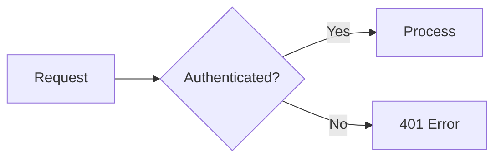
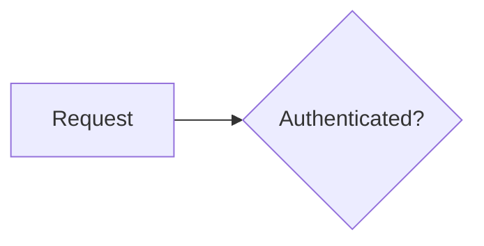

# Feature Research: v1.4.0 Content & Navigation

**Domain:** New content types, navigation patterns, and diagram support for doc-writer plugin (milestone v1.4.0)
**Researched:** 2026-03-21
**Confidence:** MEDIUM-HIGH -- verified against official docs for sphinx-shibuya, mkdocs-material, mermaid, and diataxis; odoc gaps based on codebase analysis

---

## Feature Landscape

### Table Stakes (Users Expect These)

Features that users of a diataxis-based doc generator expect when content types and nav are expanded.

| Feature | Why Expected | Complexity | Notes |
|---------|--------------|------------|-------|
| Concepts pages under Explanation | Diataxis explicitly places conceptual "What is X?" content in the Explanation quadrant. Any doc tool claiming diataxis support must handle concept pages, not just "why" essays. The diataxis author (Daniele Procida) states that explanation serves "the need to understand and put things in a bigger picture." | LOW | Extension of existing explanation type -- add a `concepts` sub-template within explanation. Not a new diataxis quadrant, just a structured variant of explanation. Depends on: existing doc-author explanation handling. |
| Section index / landing pages | Both mkdocs-material (`navigation.indexes`) and sphinx-shibuya (toctree `index.rst`) treat section index pages as standard practice. Users navigating a tabbed doc site expect each section to have a landing page, not dump them at the first child page. Diataxis complex hierarchies doc says landing pages "should read like an overview -- not simply present lists of other content." | MEDIUM | Doc-author must generate section index pages (`index.md` / `index.rst`) with abstracts for each section. These pages need a distinct template -- they are neither tutorials nor how-tos. Depends on: navigation strategy selection. |
| Mermaid diagram support in doc-author | Mermaid is the standard diagramming tool for docs-as-code. mkdocs-material has native support via `pymdownx.superfences` custom fences. sphinxcontrib-mermaid is the standard Sphinx extension. GitHub renders mermaid natively in markdown. Users expect diagram-capable doc tools in 2026. | MEDIUM | Not about rendering (that is the doc system's job) -- it is about the doc-author knowing WHEN to suggest a diagram and WHAT diagram type fits the content. Depends on: doc-system detection (mermaid fence config for mkdocs, sphinxcontrib.mermaid for sphinx). |
| OCaml/odoc: scan-exports.sh language case | The existing gap detection script has no OCaml case. odoc is a first-class supported doc system, so gap detection must work for it. Without this, update mode (incremental docs for new features) silently skips OCaml projects. | LOW | Shell script addition. Parse `.mli` files for `val`, `type`, `module`, `exception` declarations. Depends on: nothing new -- extends existing script. |
| OCaml/odoc: doc-author .mld/.mli handling | odoc documentation uses `.mld` files for narrative pages and `.mli` files for API docs. The current doc-author writes `.md` files to `docs_root`, which is wrong for odoc projects. odoc reads `.mld` from `doc/` directory in dune projects. | MEDIUM | Doc-author needs conditional output: `.mld` with odoc markup syntax when `doc_system: odoc`, `.md` otherwise. Requires a mapping from diataxis templates to `.mld` structural patterns. Depends on: doc-system detection. |

### Differentiators (Competitive Advantage)

Features that set doc-writer apart. Not expected from most doc tools, but valuable.

| Feature | Value Proposition | Complexity | Notes |
|---------|-------------------|------------|-------|
| Use Cases as a content type with setup Q&A capture | Use cases bridge the gap between "what a library does" (README features list) and "how to use it for your situation" (tutorials/how-tos). Stripe and Twilio structure docs around real developer goals, not just API endpoints. Capturing use cases during setup Q&A -- before User Persona generation -- lets the persona agent generate scenarios grounded in real user goals, not abstract ones. | MEDIUM | This is NOT a new diataxis quadrant. Diataxis creator explicitly rejects a 5th type: "There are four, because that's what emerges from the two-axis arrangement." Use cases are a CROSS-CUTTING concern that maps to existing types: a use case scenario produces how-to guides (task-oriented) or tutorials (learning-oriented). The value is in the capture mechanism and the downstream enrichment, not a new page template. |
| Smart nav strategy selection (3 strategies) | Most doc tools offer one nav approach. Offering three strategies -- (1) no tabs, (2) single "Docs" tab, (3) sections-as-tabs -- with the setup Q&A recommending the right one based on project size is a real differentiator. Small projects get sidebar-only; medium projects get a single Docs tab; large diataxis-structured projects get sections-as-tabs. | MEDIUM | Sphinx-shibuya uses `nav_links` with `children` for dropdown menus. mkdocs-material uses `navigation.tabs` feature flag. The strategies are framework-specific in implementation but share the same decision logic. Depends on: existing nav Q&A questions (already in both .qa.md files -- needs refinement, not creation from scratch). |
| Diagram type recommendation engine | Instead of just supporting mermaid syntax, doc-author actively recommends the RIGHT diagram type for the content being written. Flowcharts for process flows, sequence diagrams for API interactions, class diagrams for type hierarchies, state diagrams for lifecycle docs. This is the difference between "we support diagrams" and "we help you use diagrams well." | LOW-MEDIUM | Add diagram type guidance to the doc-author agent. No new infrastructure -- just decision rules: "If explaining a request/response flow, suggest a sequence diagram. If explaining state transitions, suggest a state diagram." Depends on: mermaid support detection. |
| Section index abstracts | Section landing pages that include short abstracts for each child page (not just a list of links) help users navigate. The diataxis complex hierarchies doc emphasizes "headings and snippets of introductory text" over bare lists. Doc-author generating these abstracts from the page inventory is unique -- most tools require hand-writing section indexes. | LOW | Doc-author already has the page inventory with titles and key sections. Generating a 1-2 sentence abstract per page for the section index is straightforward. Depends on: section index page generation. |

### Anti-Features (Commonly Requested, Often Problematic)

| Feature | Why Requested | Why Problematic | Alternative |
|---------|---------------|-----------------|-------------|
| Use Cases as a separate nav section / diataxis quadrant | Feels like use cases deserve their own section in the docs, separate from tutorials and how-tos. | Diataxis explicitly rejects a 5th type. The framework creator says example projects (the closest analog to use cases) belong in Explanation. Adding a separate "Use Cases" nav section creates content that overlaps with how-to guides and tutorials, confusing readers about where to look. | Capture use cases during setup Q&A. Use them to INFORM what tutorials and how-to guides to write, and to enrich persona scenarios. Optionally promote high-value use cases to a "Use Cases" subsection under How-To Guides or as a distinct explanation page -- but never as a top-level diataxis quadrant. |
| Dropdown menus in mkdocs-material tabs | Sphinx-shibuya supports dropdown nav via `children` in `nav_links`. Seems like mkdocs-material should too. | mkdocs-material does NOT support dropdown menus in navigation tabs. Tabs are flat -- each tab maps to a top-level nav section. Attempting to add dropdowns requires custom CSS/JS hacks that break with theme updates and don't work on mobile. | Use `navigation.tabs` + `navigation.sections` combination in mkdocs-material. Level 2 items render as section groups in the sidebar, which is the official pattern for deep nav hierarchies. |
| Auto-generating mermaid diagrams from code | Since the doc-author has access to the codebase, it could auto-generate class diagrams, sequence diagrams, etc. from source code. | Auto-generated diagrams are noisy, include internal details, and drift out of sync with manually-curated narrative. They serve the builder's mental model, not the reader's. | Doc-author RECOMMENDS where a diagram would help and SUGGESTS the diagram type. The author writes the diagram content from the user's perspective, showing only what the reader needs to understand. |
| Per-page nav strategy overrides | Allow different nav strategies for different sections of the docs. | Creates inconsistent UX. Users expect one navigation pattern across the entire doc site. Mixed strategies (some sections have tabs, others don't) confuse readers. | One nav strategy per project, selected during setup. All sections follow the same pattern. |
| Glossary as a separate page type | Many doc systems have glossary features (Sphinx `.. glossary::`, mkdocs plugins). Seems like doc-writer should generate a standalone glossary. | A standalone glossary page is rarely useful for library docs (it's more common in enterprise/product docs). Library users look up terms in context, not alphabetically. The effort to maintain a glossary that stays in sync is high. | Concepts pages under Explanation serve the same need better -- each concept gets its own focused page with context. The Editor agent's terminology consistency enforcement handles cross-page term alignment. |

---

## Feature Dependencies

```
Use Cases setup Q&A capture
    |-- enriches --> User Persona scenario generation (existing)
    |-- enriches --> Doc-author page inventory (existing)
    |-- optionally promotes to --> How-To Guides subsection or Explanation page

Concepts page template (under Explanation)
    |-- requires --> Existing explanation reference (already exists)
    |-- used by --> Doc-author page inventory classification
    |-- enhances --> Section index abstracts

Nav strategy selection (3 strategies)
    |-- requires --> Nav Q&A refinement (existing Q&A files)
    |-- determines --> Section index page generation
    |-- framework-specific:
        |-- sphinx-shibuya: nav_links with children (dropdowns supported)
        |-- mkdocs-material: navigation.tabs + navigation.sections (no dropdowns)
        |-- odoc: not applicable (odoc has fixed nav)
        |-- plain-markdown: not applicable (no nav framework)

Section index pages with abstracts
    |-- requires --> Nav strategy selection (tabs need indexes)
    |-- requires --> Page inventory (for abstract generation)
    |-- framework-specific output:
        |-- sphinx: index.rst with toctree
        |-- mkdocs: index.md with navigation.indexes feature

Mermaid diagram awareness
    |-- requires --> Doc-system mermaid detection (config scan)
    |-- used by --> Doc-author during page writing
    |-- framework-specific syntax:
        |-- mkdocs: ```mermaid fenced blocks
        |-- sphinx: .. mermaid:: directive
        |-- plain-markdown: ```mermaid (GitHub-rendered)
        |-- odoc: not natively supported (skip or embed as image)

OCaml/odoc scan-exports.sh
    |-- independent (no new dependencies)
    |-- used by --> Gap detection in write skill update mode

OCaml/odoc .mld/.mli handling
    |-- requires --> Doc-system detection (existing)
    |-- modifies --> Doc-author output path + syntax
```

### Dependency Notes

- **Use Cases Q&A capture requires no new infrastructure** -- it extends the existing setup Q&A flow by adding questions before persona definition. The downstream enrichment flows through existing channels (config.yaml persona fields, context.md).
- **Nav strategy selection is the critical path for section indexes** -- you cannot generate section index pages without knowing whether the project uses tabs (which require indexes) or flat nav (which does not).
- **Mermaid support is framework-gated** -- odoc has no native mermaid support. The doc-author must skip diagram suggestions for odoc projects or note that diagrams require manual image embedding.
- **OCaml features are independent of all other v1.4.0 features** -- they can be built in parallel with everything else.

---

## Milestone Scope Recommendation

This is v1.4.0, not v1.0. All features below extend existing working infrastructure.

### Build First (Foundation)

These features are needed by others or have no dependencies.

- [ ] **Use Cases Q&A capture in setup** -- Add use-case questions to setup flow before persona definition. Store in config.yaml. This enriches all downstream features. LOW-MEDIUM complexity.
- [ ] **OCaml scan-exports.sh language case** -- Independent fix. Unblocks update mode for OCaml projects. LOW complexity.
- [ ] **Concepts page sub-template under Explanation** -- Add a `concepts` variant to the explanation reference. Doc-author uses it when classifying "What is X?" pages. LOW complexity.

### Build Second (Depends on Foundation)

- [ ] **Nav strategy refinement (3 strategies)** -- Refine existing nav Q&A to present three distinct strategies with recommendations. Update guidance files with strategy-specific patterns. MEDIUM complexity.
- [ ] **Mermaid diagram awareness** -- Add diagram type decision rules to doc-author. Detect mermaid support from framework config. Generate framework-specific syntax. MEDIUM complexity.
- [ ] **OCaml doc-author .mld/.mli handling** -- Conditional output format in doc-author for odoc projects. MEDIUM complexity.

### Build Third (Depends on Second)

- [ ] **Section index pages with abstracts** -- Generate landing pages for each nav section. Requires nav strategy to be selected. Uses page inventory for abstracts. MEDIUM complexity.
- [ ] **Use Cases optional promotion to docs section** -- After page inventory is proposed, offer to promote captured use cases to how-to guides or explanation pages. LOW complexity once use cases are captured and page inventory exists.

### Defer (v1.5+)

- [ ] **Glossary page generation** -- Low value for library docs. Concepts pages serve the need better.
- [ ] **Per-page diagram style configuration** -- Premature. Let doc-author make diagram decisions based on content type first. Add configurability if users request it.

---

## Feature Prioritization Matrix

| Feature | User Value | Implementation Cost | Priority | Depends On |
|---------|------------|---------------------|----------|------------|
| Use Cases Q&A capture | HIGH | LOW-MEDIUM | P1 | Existing setup flow |
| Concepts page template | MEDIUM | LOW | P1 | Existing explanation reference |
| OCaml scan-exports.sh | MEDIUM | LOW | P1 | Nothing new |
| Nav strategy selection (3 strategies) | HIGH | MEDIUM | P1 | Existing Q&A files |
| Mermaid diagram awareness | MEDIUM | MEDIUM | P2 | Doc-system detection |
| OCaml .mld/.mli handling | MEDIUM | MEDIUM | P2 | Doc-system detection |
| Section index pages + abstracts | HIGH | MEDIUM | P2 | Nav strategy, page inventory |
| Use Cases promotion to docs | MEDIUM | LOW | P2 | Use Cases Q&A, page inventory |

**Priority key:**
- P1: Build first -- foundational or independent
- P2: Build second -- depends on P1 features or less critical

---

## Detailed Feature Analysis

### 1. Use Cases as a Content Type

**What the ecosystem does:** Use cases in library documentation are NOT a separate content type in diataxis. The diataxis framework has exactly four types, and its creator explicitly rejects adding more: "There are four, because that's what emerges from the two-axis arrangement." When asked about example projects as a 5th section, Procida categorized them as Explanation (theoretical knowledge for study).

However, real-world documentation leaders (Stripe, Twilio) organize content around use cases -- real developer goals like "Accept a payment" or "Send an SMS." These are not labeled "use cases" in the nav; they are structured as how-to guides or tutorials depending on the audience. The use case is the organizing principle, not the content type.

**Recommendation for doc-writer:** Use cases should be a **setup Q&A capture mechanism**, not a page type. During setup:
1. Ask "What are the main things people use this library for?" (before persona definition)
2. Store responses as `use_cases` array in config.yaml (each with `name`, `description`, `typical_user`)
3. Feed use cases into persona scenario generation (User Persona agent gets richer test scenarios)
4. Feed use cases into doc-author page inventory (Author proposes how-to guides or tutorials that address each use case)
5. Optionally: after page inventory, ask if any use cases warrant a dedicated "Use Cases" subsection (under How-To Guides or as explanation pages)

**Relationship to tutorials/how-to guides:**
- A use case where the user is LEARNING maps to a **tutorial** ("Getting started with payment processing")
- A use case where the user is DOING maps to a **how-to guide** ("How to handle subscription billing")
- A use case that needs BACKGROUND maps to an **explanation** ("Understanding payment states and lifecycle")

**Confidence:** HIGH -- diataxis framework is well-documented and the creator's position on additional types is explicit.

### 2. Concepts / Glossary Pages in Diataxis

**Where concepts fit:** Concepts pages are a sub-type of **Explanation**. Diataxis defines explanation as "understanding-oriented documentation that provides context and background." A "Concepts" page answering "What is a middleware?" or "What are hooks?" is textbook explanation content.

**Recommended implementation:** Add a `concepts` variant to the explanation reference file. When doc-author classifies a page, it should distinguish between:
- **Explanation (design):** "Why we use event-driven architecture" -- design decisions, trade-offs
- **Explanation (concepts):** "What is a middleware?" -- definitions with context, not just glossary entries

The concepts variant has a tighter template:
- Term/concept name as title
- One-paragraph definition
- How it works in this library (with code example)
- Relationship to other concepts
- Common misconceptions

**Why NOT a glossary page:** Library docs benefit more from contextual concept pages than alphabetical glossary lists. Each concept page has room for examples and relationships. A glossary entry ("Middleware: a function that intercepts requests") is too terse to be useful and too disconnected from usage.

**Section placement:** Concepts pages go under Explanation in the nav. If using sections-as-tabs, they appear under the "Explanation" tab. If using sidebar-only, they appear under an "Explanation" or "Concepts" heading.

**Confidence:** HIGH -- directly supported by diataxis framework definition.

### 3. Sphinx-Shibuya Nav Patterns

**How nav_links work:** Shibuya uses `nav_links` in `html_theme_options` in conf.py. Each link has `title` and `url`. Dropdown menus are supported via `children` arrays:

```python
html_theme_options = {
    "nav_links": [
        {
            "title": "Tutorials",
            "url": "tutorials",
            "children": [
                {"title": "Getting Started", "url": "tutorials/getting-started", "summary": "Your first steps"},
                {"title": "Advanced Usage", "url": "tutorials/advanced", "summary": "Deep dive"}
            ]
        }
    ]
}
```

Child items support `summary` for contextual descriptions and `external: True` for external links.

**Three recommended strategies:**

| Strategy | When to Use | nav_links Config |
|----------|-------------|-----------------|
| **No tabs** (sidebar only) | Small projects (under 10 pages total). All diataxis sections have 1-3 pages each. | No `nav_links` -- all nav in left sidebar toctree. |
| **Single "Docs" tab** | Medium projects (10-30 pages). Enough content to benefit from a landing page but not enough for per-section tabs. | One `nav_links` entry pointing to docs index. Other nav links for GitHub, changelog, etc. |
| **Sections-as-tabs with dropdowns** | Large diataxis-structured projects (30+ pages). Each section (Tutorials, How-To, Explanation, Reference) has enough content to justify its own tab. | One `nav_links` entry per diataxis section, each with `children` listing key pages. Dropdown provides quick access without cluttering the top bar. |

**Key insight:** Shibuya's `nav_links` are completely independent of the toctree. The toctree drives the left sidebar; `nav_links` drive the top navbar. This means the doc-author must configure BOTH -- toctree structure in index.rst files AND nav_links in conf.py.

**Confidence:** HIGH -- verified against official Shibuya docs at shibuya.lepture.com/customisation/navbar/.

### 4. MkDocs-Material Navigation Tabs

**How tabs interact with left nav:** When `navigation.tabs` is enabled:
- Top-level nav sections render as tabs in the header (above 1220px viewport)
- The left sidebar shows ONLY the content of the active tab
- On mobile, tabs collapse back into the sidebar

**Key combinations:**
- `navigation.tabs` alone: tabs replace top-level sidebar entries
- `navigation.tabs` + `navigation.sections`: level 2 items render as bold section groups in the sidebar
- `navigation.tabs` + `navigation.tabs.sticky`: tabs stay visible when scrolling
- `navigation.indexes`: allows section index pages (`index.md` as first child of a nav section)

**Critical difference from Shibuya:** mkdocs-material tabs are **flat** -- no dropdown menus. Each tab maps to a top-level nav section. If you have a "Tutorials" tab, all tutorial pages appear in the sidebar when that tab is active. There is no dropdown on hover.

**Three recommended strategies (matching Shibuya but framework-appropriate):**

| Strategy | When to Use | mkdocs.yml Config |
|----------|-------------|-------------------|
| **No tabs** | Small projects (under 10 pages). | `navigation.sections` only. All content in sidebar. |
| **Single "Docs" tab** | Medium projects with docs + external nav. | `navigation.tabs` with one nav section for all docs, others for GitHub/Blog/Changelog. |
| **Sections-as-tabs** | Large diataxis projects. Each diataxis section is a tab. | `navigation.tabs` + `navigation.sections` + `navigation.indexes`. Each diataxis section is a top-level nav entry with `index.md`. |

**Incompatibilities to watch:**
- `navigation.indexes` is incompatible with `toc.integrate` (official docs confirm this)
- `navigation.tabs.sticky` requires `navigation.tabs` (obvious but easy to miss in config generation)

**Confidence:** HIGH -- verified against official mkdocs-material docs at squidfunk.github.io.

### 5. Mermaid Diagrams in Documentation

**When diagrams are most useful in library docs:**

| Diagram Type | Best For | Example Use Case |
|--------------|----------|-----------------|
| **Flowchart** | Decision flows, request processing pipelines, conditional logic | "How the middleware chain processes a request" |
| **Sequence diagram** | API interactions, client-server flows, multi-step protocols | "Authentication flow between client, server, and OAuth provider" |
| **Class diagram** | Type hierarchies, plugin interfaces, inheritance relationships | "Relationship between base Handler and its implementations" |
| **State diagram** | Lifecycle management, connection states, resource states | "WebSocket connection lifecycle: connecting, open, closing, closed" |
| **ER diagram** | Data models, configuration schemas, entity relationships | "Relationship between User, Project, and Permission entities" |

**Diagram types to AVOID in library docs:**
- **Gantt charts** -- project management, not library usage
- **Pie charts** -- statistics, not library architecture
- **Git graphs** -- development workflow, not user-facing
- **User journey** -- product design, not library docs (overlap with use cases but wrong abstraction level)

**Framework-specific syntax:**

mkdocs-material (native support via pymdownx.superfences):
````markdown

````

Sphinx with sphinxcontrib-mermaid:
```rst
.. mermaid::

   graph LR
       A[Request] --> B{Authenticated?}
       B -->|Yes| C[Process]
       B -->|No| D[401 Error]
```

Plain markdown (GitHub renders natively):
````markdown

````

odoc: No native mermaid support. Options are (a) embed as pre-rendered SVG image, or (b) skip diagrams for odoc projects. Recommendation: skip diagram suggestions for odoc unless the project has a separate docs site.

**Dark mode support:** Both mkdocs-material and sphinx-shibuya (with sphinxcontrib-mermaid) handle dark mode automatically -- diagrams adapt to the site's color scheme. No doc-author action needed.

**Confidence:** HIGH -- verified against official docs for both mkdocs-material and sphinxcontrib-mermaid.

---

## Competitor Feature Analysis

| Feature | Sphinx (manual) | MkDocs (manual) | Mintlify | ReadMe.com | doc-writer v1.4 |
|---------|-----------------|-----------------|----------|------------|-----------------|
| Use case capture | Manual | Manual | Template-based | Built-in sections | Q&A-driven, feeds pipeline |
| Concepts pages | Manual explanation pages | Manual | Glossary pages | Glossary widget | Sub-template of explanation |
| Nav strategy guidance | Theme docs only | Theme docs only | Opinionated default | Fixed layout | 3 strategies with recommendations |
| Mermaid support | Via extension | Native (Material) | Native | Native | Aware + recommends diagram types |
| Section index generation | Manual index.rst | Manual index.md | Auto-generated | N/A | Auto-generated with abstracts |
| Diagram type guidance | None | None | None | None | Content-aware recommendations |

---

## Sources

- [Diataxis framework](https://diataxis.fr/) -- quadrant definitions, explanation of four types (HIGH confidence)
- [Diataxis complex hierarchies](https://diataxis.fr/complex-hierarchies/) -- landing page patterns, section structure (HIGH confidence)
- [Diataxis GitHub Discussion #36](https://github.com/evildmp/diataxis-documentation-framework/discussions/36) -- creator's rejection of 5th type, examples classified as explanation (HIGH confidence)
- [Shibuya navbar configuration](https://shibuya.lepture.com/customisation/navbar/) -- nav_links with children/dropdowns (HIGH confidence)
- [MkDocs Material navigation setup](https://squidfunk.github.io/mkdocs-material/setup/setting-up-navigation/) -- tabs, sections, indexes (HIGH confidence)
- [MkDocs Material diagrams](https://squidfunk.github.io/mkdocs-material/reference/diagrams/) -- mermaid configuration, supported types (HIGH confidence)
- [sphinxcontrib-mermaid](https://shibuya.lepture.com/extensions/mermaid/) -- Sphinx mermaid integration with Shibuya (HIGH confidence)
- [Stripe/Twilio documentation patterns](https://devdocs.work/post/stripe-twilio-achieving-growth-through-cutting-edge-documentation) -- use-case-driven doc structure (MEDIUM confidence -- secondary source)
- [I'd Rather Be Writing on Diataxis](https://idratherbewriting.com/blog/what-is-diataxis-documentation-framework) -- practical analysis of framework adoption (MEDIUM confidence)
- [odoc documentation](https://ocaml.github.io/odoc/) -- .mld/.mli file handling (HIGH confidence)
- Existing codebase: doc-author.md, sphinx-shibuya.md, mkdocs-material.md, .qa.md files, diataxis skill (HIGH confidence -- primary source)

---
*Feature research for: doc-writer v1.4.0 Content & Navigation milestone*
*Researched: 2026-03-21*
