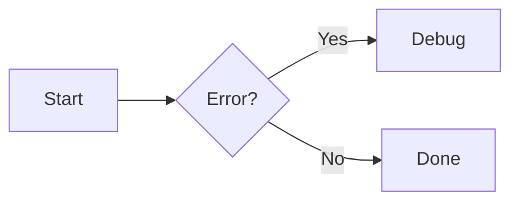
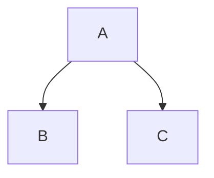

# Stack Research: v1.4.0 Content & Navigation

**Domain:** Doc-writer plugin -- new features for Shibuya dropdown nav, MkDocs-material tabs, mermaid diagrams, OCaml .mld/.mli generation
**Researched:** 2026-03-21
**Confidence:** HIGH -- all findings verified via official documentation (WebFetch on primary sources)

**Scope:** Only NEW stack additions for v1.4.0 features. Existing validated stack (three-agent pipeline, four doc systems, scaffold templates, etc.) is not re-researched.

---

## 1. Shibuya nav_links with children/dropdown Menus

### What Already Exists

The current scaffold (`scaffolds/sphinx-shibuya.py`) has flat `nav_links`:

```python
"nav_links": [
    {"title": "Tutorials", "url": "tutorials/index"},
    {"title": "How-To Guides", "url": "how-to/index"},
    {"title": "Explanation", "url": "explanation/index"},
    {"title": "Reference", "url": "reference/index"},
],
```

### What Needs to Change

Shibuya supports `children` on nav_link items for dropdown menus. This is NOT a new library -- it is an existing Shibuya feature that was not used in v1.0.

**Verified nav_link item fields (from shibuya.lepture.com/customisation/navbar/):**

| Field | Type | Applies To | Purpose |
|-------|------|------------|---------|
| `title` | string | parent + child | Display text |
| `url` | string | parent + child | Link destination |
| `children` | array | parent only | Nested dropdown items |
| `summary` | string | child only | Short description shown in dropdown |
| `external` | boolean | parent + child | Shows external link icon |
| `resource` | boolean | parent + child | Prevents `.html` suffix appending |

**Example -- sections-as-tabs with dropdown children:**

```python
"nav_links": [
    {
        "title": "Tutorials",
        "url": "tutorials/index",
        "children": [
            {
                "title": "Getting Started",
                "url": "tutorials/getting_started",
                "summary": "Install, configure, and run your first example"
            },
            {
                "title": "Advanced Workflows",
                "url": "tutorials/advanced_workflows",
                "summary": "Build production-ready pipelines"
            },
        ],
    },
    {
        "title": "Reference",
        "url": "reference/index",
    },
],
```

**Confidence:** HIGH -- verified from official Shibuya navbar documentation via WebFetch.

### Stack Impact: Zero New Dependencies

No new libraries needed. The change is purely in:
1. **Guidance file** (`sphinx-shibuya.md`): Document the `children` + `summary` fields and when to use dropdowns vs flat nav_links
2. **Scaffold template** (`scaffolds/sphinx-shibuya.py`): Add three nav strategy variants (no tabs, "Docs" tab, sections-as-tabs with dropdowns)
3. **Q&A file** (`sphinx-shibuya.qa.md`): Add nav strategy question with three options

### Section Index :description: Metadata

Shibuya does NOT have a `:description:` metadata directive that auto-populates dropdown summaries from section index pages. The `summary` field on children is manually specified in `conf.py` `nav_links` configuration.

However, RST section index pages CAN include descriptive introductory text, and the doc-author agent should write an abstract paragraph at the top of each section `index.rst`. This abstract serves two purposes:
1. Content for the section landing page itself
2. Source text that the user can copy into the `summary` field in `conf.py` nav_links

The guidance file should instruct the doc-author to write these abstracts and note that they should be mirrored in `conf.py` `summary` fields when dropdowns are enabled.

**Confidence:** HIGH -- verified `summary` is manual-only (not derived from page content).

---

## 2. MkDocs-Material Navigation Tabs Configuration

### What Already Exists

The current scaffold (`scaffolds/mkdocs-material.yml`) includes `navigation.sections` but NOT `navigation.tabs`:

```yaml
features:
  - navigation.instant
  - navigation.sections
  - navigation.top
  - navigation.tracking
```

The current guidance file (`mkdocs-material.md`) mentions tabs conceptually but the scaffold does not wire them.

### What Needs to Change

**Verified feature flags (from squidfunk.github.io/mkdocs-material/setup/setting-up-navigation/):**

| Feature Flag | Purpose | Use When |
|-------------|---------|----------|
| `navigation.tabs` | Top-level nav sections become horizontal tabs below header (viewports > 1220px) | Projects with 3+ Diataxis sections having multiple pages each |
| `navigation.tabs.sticky` | Tabs stay visible while scrolling down | Always pair with `navigation.tabs` for better UX |
| `navigation.sections` | Top-level sections render as groups in sidebar | Combine with `navigation.tabs` for level-2 section grouping |
| `navigation.indexes` | Section index pages (index.md) attach directly to section header | Use when sections have overview/landing pages |

**Three nav strategy variants for the scaffold:**

1. **No tabs (flat sidebar):** Current default. Best for small projects (all sections have 1-2 pages).
   ```yaml
   features:
     - navigation.sections
     - navigation.indexes
   ```

2. **"Docs" tab (single documentation tab):** One top tab labeled "Documentation" with sidebar for Diataxis sections. Best for projects where docs are one section alongside blog/about pages.
   ```yaml
   features:
     - navigation.tabs
     - navigation.sections
     - navigation.indexes
   ```

3. **Sections-as-tabs:** Each Diataxis quadrant is a top tab. Best for projects with 3+ pages per section.
   ```yaml
   features:
     - navigation.tabs
     - navigation.tabs.sticky
     - navigation.sections
     - navigation.indexes
   ```
   Combined with a `nav:` key that groups pages under Diataxis headings:
   ```yaml
   nav:
     - Home:
       - index.md
     - Tutorials:
       - tutorials/index.md
       - tutorials/getting-started.md
     - How-To Guides:
       - how-to/index.md
     - Explanation:
       - explanation/index.md
     - Reference:
       - reference/index.md
   ```

**MkDocs-material does NOT support dropdown menus on tabs.** Tabs are strictly flat. Sub-navigation is handled by the sidebar. This is a key difference from Shibuya.

### Section Index Description

MkDocs-material uses `description` in YAML frontmatter on `index.md` pages:

```yaml
---
title: Tutorials
description: Step-by-step guides to learn the library from scratch
---
```

This description appears in search results, link previews, and can be referenced by the `meta` plugin. The existing guidance file already documents `title` and `description` frontmatter. No new mechanism needed -- just ensure the doc-author writes descriptive frontmatter on section index pages.

### Stack Impact: Zero New Dependencies

All navigation features are built into mkdocs-material. Changes are in:
1. **Guidance file** (`mkdocs-material.md`): Expand Navigation section with three strategies, `navigation.indexes` feature
2. **Scaffold template** (`scaffolds/mkdocs-material.yml`): Add `navigation.tabs`, `navigation.tabs.sticky`, `navigation.indexes` features
3. **Q&A file** (`mkdocs-material.qa.md`): Add nav strategy question matching Shibuya's three options

**Confidence:** HIGH -- verified from official mkdocs-material navigation docs.

---

## 3. Mermaid Diagram Support Across All 4 Doc Systems

### Per-System Requirements

#### MkDocs-Material: Already Configured (Zero Changes Needed)

The existing scaffold ALREADY has mermaid support via `pymdownx.superfences`:

```yaml
- pymdownx.superfences:
    custom_fences:
      - name: mermaid
        class: mermaid
        format: !!python/name:pymdownx.superfences.fence_code_format
```

Mermaid diagrams use standard fenced code blocks:

````markdown

````

No library additions needed. mkdocs-material handles mermaid.js loading, theming (light/dark mode), and rendering automatically.

**Stack impact:** None. Only guidance file needs a "Mermaid Diagrams" section documenting the syntax and when to use which diagram types.

**Confidence:** HIGH -- verified existing scaffold already has the config; verified syntax from official docs.

#### Sphinx-Shibuya: sphinxcontrib-mermaid (NEW Dependency)

| Library | Version | Purpose | Why |
|---------|---------|---------|-----|
| sphinxcontrib-mermaid | >= 2.0.1 | Mermaid diagram rendering in Sphinx | Stable 2.0 release (2026-03-05), Shibuya has built-in dark/light mode support, fullscreen viewing, responsive SVG |

**conf.py addition:**
```python
extensions = [
    # ... existing extensions ...
    "sphinxcontrib.mermaid",
]
```

**RST directive syntax:**
```rst
.. mermaid::

   graph LR
     A[Start] --> B{Error?}
     B -->|Yes| C[Debug]
     B -->|No| E[Done]
```

**Directive options:** `:name:`, `:alt:`, `:align:`, `:caption:`, `:zoom:`, `:fullscreen:`

**Shibuya integration notes (from shibuya.lepture.com/extensions/mermaid/):**
- Shibuya auto-detects dark/light mode and applies appropriate mermaid theme
- Built-in fullscreen modal viewing for diagrams
- Responsive SVG styling (500px height, 100% width)
- Conflict resolution: if using nbsphinx, set `nbsphinx_requirejs_path = ''`

**Stack impact:** One new pip dependency. Scaffold conf.py needs `sphinxcontrib.mermaid` in extensions list. Guidance file needs mermaid section.

**Installation:**
```bash
pip install sphinxcontrib-mermaid
```

**Confidence:** HIGH -- version 2.0.1 verified on PyPI (2026-03-05), Shibuya integration page verified via WebFetch.

#### Plain Markdown / GitHub: Native Support (Zero Dependencies)

GitHub renders mermaid natively in `.md` files, issues, PRs, discussions, and wikis. Syntax is identical to MkDocs-material:

````markdown

````

**Limitations (verified from GitHub docs):**
- No tooltips, callbacks, or interactive features
- Some emoji and extended ASCII characters break rendering
- Not all Mermaid features are supported (hyperlinks, click events)

**Stack impact:** None. Only guidance file needs a section documenting the syntax and GitHub's limitations.

**Confidence:** HIGH -- verified from docs.github.com/en/get-started/writing-on-github/working-with-advanced-formatting/creating-diagrams.

#### Odoc (OCaml): No Native Mermaid Support

Odoc has NO built-in mermaid directive. There is an experimental `odoc-mermaid-extension` being developed as an odoc plugin, but it is not production-ready and not available on opam as a stable package.

**Workaround options (ranked):**

1. **Verbatim block with note (RECOMMENDED):** Use `{v ... v}` for the mermaid source as documentation alongside a pre-rendered image:
   ```
   {1 Architecture}

   .. image rendered from the mermaid source below ..

   {v
   graph LR
     A[Client] --> B[Server]
     B --> C[Database]
   v}
   ```
   The verbatim block preserves the mermaid source for maintainability. The rendered diagram must be a separate image file (PNG/SVG) linked with `{{:images/arch.svg} Architecture diagram}` or the odoc 3.x `{image:...}` tag.

2. **External rendering + image embedding:** Render mermaid to SVG using `mmdc` CLI, commit the SVG, reference it in docs. This is the most reliable approach for production docs.

3. **Skip mermaid in odoc:** Simply do not include mermaid diagrams in odoc projects. The doc-author agent should be aware that mermaid is unavailable and use text descriptions or ASCII art instead.

**Recommendation for doc-author guidance:** When the doc system is `odoc`, the agent should:
- Write architecture/flow descriptions in prose (not diagrams)
- If a diagram is essential, include the mermaid source in a `{v ... v}` block with a note that it can be rendered externally
- NOT attempt to use a `{@mermaid[ ... ]}` block (this does not exist)

**Stack impact:** None. Guidance-only change in odoc.md.

**Confidence:** MEDIUM -- verified no stable mermaid extension exists for odoc; workaround approach is a recommendation, not a verified community pattern.

### Mermaid Diagram Types for Doc-Author Awareness

The doc-author agent needs guidance on WHICH diagram types to use in documentation:

| Diagram Type | When to Use | All Systems? |
|-------------|-------------|--------------|
| Flowchart (`graph TD/LR`) | Architecture overviews, decision flows | Yes (except odoc) |
| Sequence diagram | API call flows, request/response | Yes (except odoc) |
| Class diagram | Type hierarchies, module relationships | Yes (except odoc) |
| State diagram | Lifecycle states, workflow states | Yes (except odoc) |
| ER diagram | Data model relationships | Yes (except odoc) |

**Anti-patterns:** Do not use mermaid for simple relationships that prose can explain. Reserve diagrams for complex multi-component interactions where visual representation genuinely aids understanding.

---

## 4. OCaml .mld/.mli File Generation in doc-author

### What Already Exists

The current doc-author agent (`agents/doc-author.md`) writes ALL output as Markdown files to `paths.docs_root`. It has no awareness of:
- Writing `.mld` files to `doc/` directory (odoc page files)
- Writing `.mli` documentation comments (interface files)
- Registering `.mld` files in `(mld_files ...)` in `doc/dune`

The odoc guidance file (`odoc.md`) comprehensively documents `.mld` syntax, `.mli` comment syntax, dune wiring, and cross-references -- but the doc-author agent does not use this guidance for file output decisions.

### What Needs to Change

The doc-author agent needs an **odoc output mode** that changes file generation behavior:

#### .mld File Generation (Narrative Pages)

When `doc_system: odoc`, tutorial/how-to/explanation pages should be `.mld` files written to `doc/` (not `.md` files to `docs_root`).

**File path mapping:**
| Diataxis Type | Markdown Output | Odoc Output |
|---------------|----------------|-------------|
| Tutorial | `docs/tutorials/getting-started.md` | `doc/getting_started.mld` |
| How-to | `docs/how-to/configure-auth.md` | `doc/configure_auth.mld` |
| Explanation | `docs/explanation/architecture.md` | `doc/architecture.mld` |
| Section index | `docs/tutorials/index.md` | Part of `doc/index.mld` (linked via `{!page-getting_started}`) |

**Key rules for .mld generation:**
1. Filename: underscores only, never hyphens (existing guidance, critical)
2. Page title: `{0 Page_title - Brief description}` (only in .mld, never in .mli)
3. Heading levels: `{1 ...}`, `{2 ...}`, `{3 ...}` (NOT `{0 ...}` for body sections)
4. Code blocks: `{[ ... ]}` for OCaml, `{@lang[ ... ]}` for other languages, `{v ... v}` for verbatim
5. Cross-refs: `{!page-name}` for same-package pages, HTML URLs for cross-package
6. MUST register in `(mld_files ...)` in `doc/dune` -- the agent should append to the list or note the registration requirement

#### .mli Documentation Comments (API Reference Enhancement)

The doc-author agent should NOT write full .mli files (that is code generation, out of scope). Instead, it should:

1. **Scan existing .mli files** for undocumented public values (functions, types, modules with no `(** ... *)` comment)
2. **Propose doc comment additions** as patches or complete comment blocks that can be inserted above undocumented declarations
3. **Follow .mli comment structure:**
   - Module-level: first paragraph = synopsis (appears in `{!modules:}` lists)
   - Function-level: summary, extended description, `{[ ... ]}` examples, `@param`/`@return`/`@raise` tags
   - Heading levels start at `{1 ...}` (NOT `{0 ...}` -- that is .mld only)

**Example output for .mli enhancement:**

```ocaml
(** Parse a configuration file into a typed record.

    Reads TOML or YAML config files and validates against the schema.
    Returns [Error] with a descriptive message for invalid configs.

    {[
    let config = Config.load "app.toml"
    (* val config : (t, string) result *)
    ]}

    @param path Filesystem path to the config file
    @return Parsed config or error message
    @raise Sys_error if the file does not exist *)
val load : string -> (t, string) result
```

### Stack Impact: Zero New Dependencies

All changes are in agent behavior (doc-author.md) and guidance files (odoc.md). No new libraries or tools.

Key implementation points:
1. **doc-author.md**: Add odoc output mode that detects `doc_system: odoc` and switches file paths from `docs_root/*.md` to `doc/*.mld`
2. **odoc.md guidance**: Already comprehensive -- needs minor additions for .mli enhancement workflow
3. **scan-exports.sh**: Needs an OCaml language case (separate from this stack research, but noted)

**Confidence:** HIGH for .mld generation approach -- follows patterns already documented in odoc.md guidance. MEDIUM for .mli enhancement -- the "propose doc comment additions" workflow needs design-phase refinement to determine exact output format.

---

## Recommended Stack Additions Summary

### New Dependencies

| Library | Version | Doc System | Purpose | Install |
|---------|---------|------------|---------|---------|
| sphinxcontrib-mermaid | >= 2.0.1 | sphinx-shibuya | Mermaid diagram rendering | `pip install sphinxcontrib-mermaid` |

That is the ONLY new dependency across all four feature areas.

### What NOT to Add

| Avoid | Why | What to Do Instead |
|-------|-----|-------------------|
| `mermaid` npm package | mkdocs-material handles mermaid.js loading internally via CDN | Use existing `pymdownx.superfences` custom_fences config |
| `sphinx-mermaid` (alternative) | Less mature than sphinxcontrib-mermaid, different API | Use sphinxcontrib-mermaid 2.0.1+ |
| `mkdocs-mermaid2-plugin` | Redundant -- pymdownx.superfences custom_fences already handles mermaid in mkdocs-material | Use existing superfences config |
| `odoc-mermaid-extension` | Experimental, not on opam stable, not production-ready | Use verbatim blocks + external rendering |
| Any diagram rendering CLI in CI | Over-engineering -- mermaid is rendered client-side in mkdocs/Sphinx/GitHub | Only needed if targeting odoc or PDF output |
| `myst-parser` for Sphinx | Locked decision: RST-native, no Markdown in Sphinx | Use RST directives exclusively |
| Manual API reference pages | Doc-author should NOT write reference pages for any framework | Use sphinx-autoapi / mkdocstrings / odoc's auto-generated module docs |

### Files That Need Modification (Not Stack, But Informative for Roadmap)

| File | Change Type | Feature |
|------|-------------|---------|
| `sphinx-shibuya.md` | Expand Navigation section, add Mermaid section | Nav dropdowns + mermaid |
| `sphinx-shibuya.qa.md` | Add nav strategy Q&A question | Nav dropdowns |
| `scaffolds/sphinx-shibuya.py` | Add `sphinxcontrib.mermaid` to extensions, add nav strategy variants | Mermaid + nav |
| `mkdocs-material.md` | Expand Navigation section, add Mermaid section | Nav tabs + mermaid |
| `mkdocs-material.qa.md` | Add nav strategy Q&A question | Nav tabs |
| `scaffolds/mkdocs-material.yml` | Add `navigation.tabs`, `navigation.tabs.sticky`, `navigation.indexes` | Nav tabs |
| `plain-markdown.md` | Add Mermaid section (GitHub-native syntax) | Mermaid |
| `odoc.md` | Add Mermaid workaround section, .mli enhancement guidance | Mermaid + .mli |
| `doc-author.md` | Add odoc output mode (.mld path routing, .mli enhancement) | .mld/.mli generation |
| `scan-exports.sh` | Add OCaml language case | Gap detection |

---

## Version Compatibility

| Package | Compatible With | Notes |
|---------|-----------------|-------|
| sphinxcontrib-mermaid >= 2.0.1 | Sphinx >= 7.0 | Python >= 3.10 required |
| sphinxcontrib-mermaid >= 2.0.1 | shibuya (any version) | Shibuya has built-in dark/light mode support for mermaid |
| sphinxcontrib-mermaid >= 2.0.1 | sphinx-design 0.6.x | No conflicts -- different directive namespaces |
| mkdocs-material (any recent) | pymdownx.superfences | Mermaid already works via existing custom_fences -- no new packages |

---

## Sources

### Primary (HIGH confidence)
- [Shibuya navbar docs](https://shibuya.lepture.com/customisation/navbar/) -- nav_links children/summary/external/resource fields, verified via WebFetch
- [Shibuya mermaid docs](https://shibuya.lepture.com/extensions/mermaid/) -- sphinxcontrib-mermaid integration with Shibuya theme, verified via WebFetch
- [MkDocs-Material navigation docs](https://squidfunk.github.io/mkdocs-material/setup/setting-up-navigation/) -- navigation.tabs, navigation.tabs.sticky, navigation.sections, navigation.indexes, verified via WebFetch
- [MkDocs-Material diagrams docs](https://squidfunk.github.io/mkdocs-material/reference/diagrams/) -- mermaid configuration via pymdownx.superfences, verified via WebFetch
- [GitHub diagrams docs](https://docs.github.com/en/get-started/writing-on-github/working-with-advanced-formatting/creating-diagrams) -- native mermaid in GitHub markdown, verified via WebFetch
- [sphinxcontrib-mermaid PyPI](https://pypi.org/project/sphinxcontrib-mermaid/) -- version 2.0.1 released 2026-03-05, verified via WebFetch
- [sphinxcontrib-mermaid 2.0 docs](https://sphinxcontrib-mermaid-demo.readthedocs.io/en/latest/) -- full config reference, verified via WebFetch
- [odoc for authors](https://ocaml.github.io/odoc/odoc/odoc_for_authors.html) -- .mld/.mli syntax, heading levels, code blocks, cross-refs, verified via WebFetch

### Secondary (MEDIUM confidence)
- [odoc 3.1.0 package docs](https://ocaml.org/p/odoc/latest/doc/odoc_for_authors.html) -- latest odoc authoring guide
- [OCaml discuss: 2025 documentation best practices](https://discuss.ocaml.org/t/2025-documentation-best-practices/17008) -- community consensus on .mli documentation

### From Existing Codebase (HIGH confidence)
- `doc-writer/skills/setup/defaults/sphinx-shibuya.md` -- current Shibuya guidance
- `doc-writer/skills/setup/defaults/mkdocs-material.md` -- current MkDocs guidance
- `doc-writer/skills/setup/defaults/odoc.md` -- current odoc guidance
- `doc-writer/skills/setup/defaults/scaffolds/sphinx-shibuya.py` -- current Sphinx scaffold
- `doc-writer/skills/setup/defaults/scaffolds/mkdocs-material.yml` -- current MkDocs scaffold
- `doc-writer/agents/doc-author.md` -- current doc-author agent
- `doc-writer/skills/write/scripts/scan-exports.sh` -- current export scanning (no OCaml case)

---
*Stack research for: doc-writer v1.4.0 Content & Navigation milestone*
*Researched: 2026-03-21*
