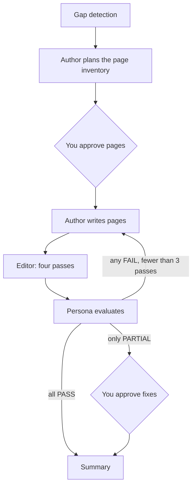

# How the pipeline works

doc-writer does not write documentation in one long prompt. Its commands hand the work to four
agents in a fixed order. Each agent has one job and a fixed set of files it may read and change.
This page explains what each agent does, how a `/doc-writer:write` run moves between them, and
why the work is split this way.

## The four agents

**Doc Researcher** runs during setup, not during the pipeline. It reads your `config.yaml`, your
README and code, and your doc system's config file, and expands the short setup answers into
`.doc-writer/context.md`: a detailed reader profile, rules for the chosen tone, and which
features of your doc system to use. The other three agents read this file at the start of every
run.

**Doc Author** writes. In a planning step it scans your public API, your tests (for realistic
usage) and your existing docs, then proposes a page inventory. After you approve it, the Author
writes each page from the reader's point of view and leaves out anything only a maintainer
would care about: test helpers, CI, build scripts and internal modules.

**Doc Editor** edits but does not add content. It checks the Author's claims against the source,
then makes four passes over the pages, always in this order:

1. **Terminology**: one spelling for each term across every page, with your source code and
   `terminology.yaml` as the authority.
2. **Page-type integrity**: finds paragraphs that drift into the wrong kind of writing, such as
   background theory in the middle of a how-to guide.
3. **Humanizer**: rewrites the patterns that make text read as machine-written, measuring each
   page before and after.
4. **Cross-references**: links code mentions to your API reference, when there is one.

Content gaps it cannot fix by editing go into its report as BLOCKING findings.

**Doc Persona** tests. It plays one configured reader, sets itself 3 to 5 concrete goals, and
tries to reach each one by following the docs from the home page. It cannot read your source
code. Each goal ends with a verdict: PASS, PARTIAL or FAIL. See
[Personas and verdicts](personas.md).

## A write run, stage by stage

1. **Gap detection** lists exported symbols that no page mentions, and in update mode the pages
   that may be stale. Output: `gap-report.md`.
2. **Author plan** proposes pages. Output: `page-inventory.md`.
3. **Approval** is your first decision point. Nothing is written until you confirm.
4. **Author write** produces the approved pages, each with hidden notes for the Editor about
   which source files it used and which claims to check.
5. **Editor** verifies those claims, runs its passes, removes the hidden notes, and writes
   `editor-report.md`.
6. **Persona** writes `scenarios.yaml` (first run only) and its report.
7. **Verdict check** routes the run: back to the Author on FAIL, to you on PARTIAL, or to the
   summary.

Every stage runs inside your Claude Code session, so the command can stop and ask you
questions. The agents are not given that ability, and an agent cannot start another agent: the
command starts each one in turn and handles every question to you.

## Create mode and update mode

The same command behaves differently depending on what is already in your docs root:

| | Create mode | Update mode |
|-|-------------|-------------|
| When | No pages, or only a starter `index.md` | Two or more pages |
| Gap detection | Undocumented symbols | Undocumented symbols and possibly stale pages |
| Author plans | A complete page set | New pages for the gaps, plus refreshes of pages that really are stale |
| Editor scope | All pages | New and refreshed pages; terminology across all pages |
| FAIL on a page the run did not touch | Not applicable | Escalated to you, never revised |

Update mode never rewrites a page you did not approve, so a later run leaves your hand
corrections alone.

## The revision loop

The pipeline runs at most three passes. After each Persona evaluation:

- **All PASS**: the run finishes.
- **Any FAIL, fewer than three passes so far**: the Author revises only the pages behind the
  failures, using the Persona's gap descriptions. The Editor runs again on those pages, and the
  Persona re-tests every scenario, because a change to one page can break the path to another.
- **Any FAIL after the third pass**: the run stops revising and prints an escalation report for
  you.
- **Only PARTIAL**: the Persona's suggested fixes are listed for you to accept or skip.

The Persona keeps the same scenarios on every pass. If the goals changed between passes, a
better verdict could mean the docs improved or the test got easier, and there would be no way to
tell which.

Only FAIL triggers automatic revision. PARTIAL means a reader got there with some friction.
Whether to fix it depends on your readers, so the pipeline leaves that decision to you.

## Separate agents

An agent that has just read your source code has context your readers lack. When it writes,
that context leaks in: it skips steps that seem obvious, names internal modules and assumes
background that isn't on the page. The same agent reviewing its draft fills the gaps from memory
without noticing them.

With separate agents, the limits are set by what each agent can open, not by instructions it
might ignore. The Persona is not told to ignore the code; it has no access to it. Whatever it
can't find in the docs, a reader can't find either. The Editor adds no new content, so its
changes can be reviewed as edits to the Author's draft.

The cost is time and tokens: a full run with revision passes involves many agent runs. The
`review` and `edit` commands exist so that after the first run you can audit and fix in smaller
steps.

## Related

- [Personas and verdicts](personas.md): how the Persona tests the docs.
- [Quality rules and the humanizer pass](quality.md): what the Author and Editor enforce.
- [Commands reference](../reference/commands.md#write): every stage's output files.
